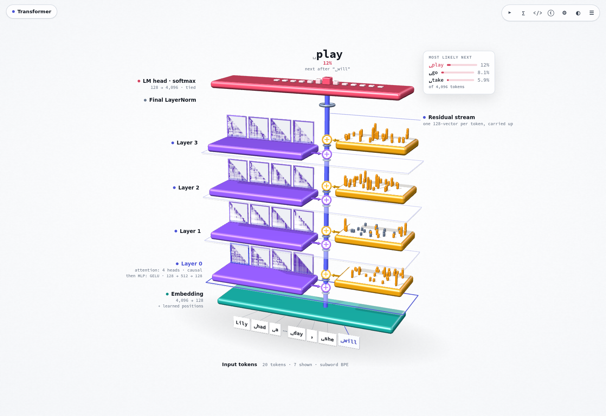
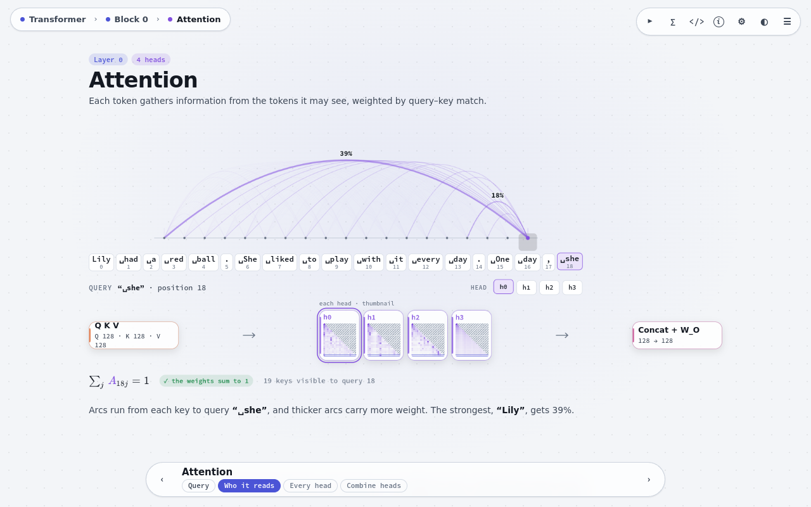
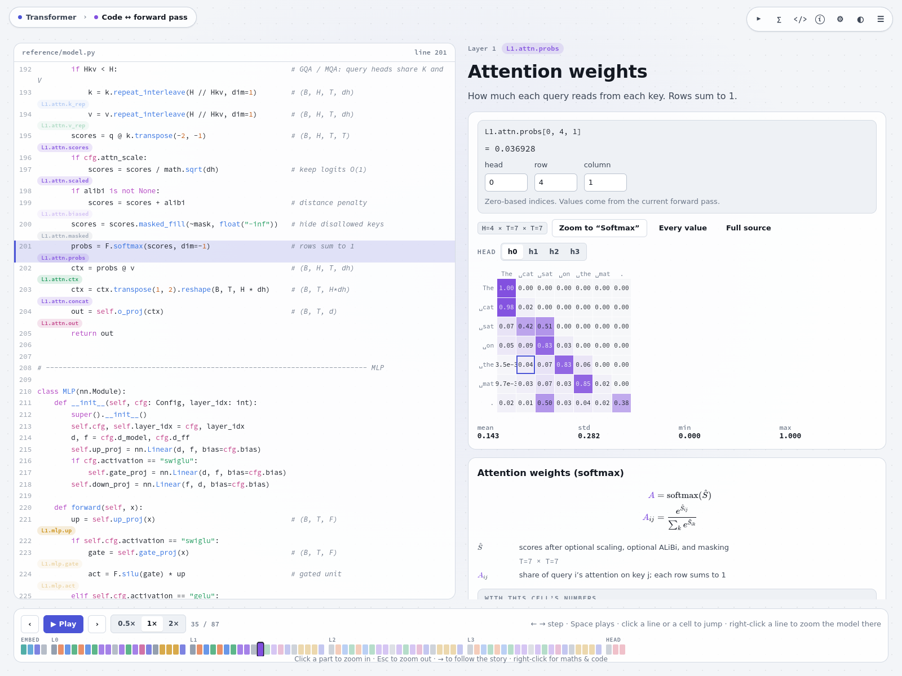
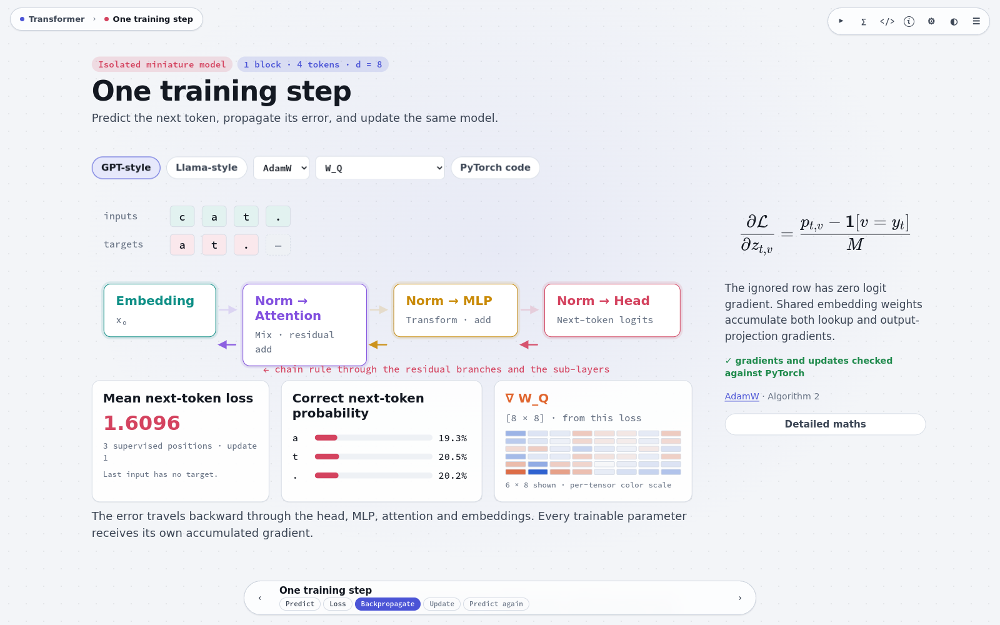
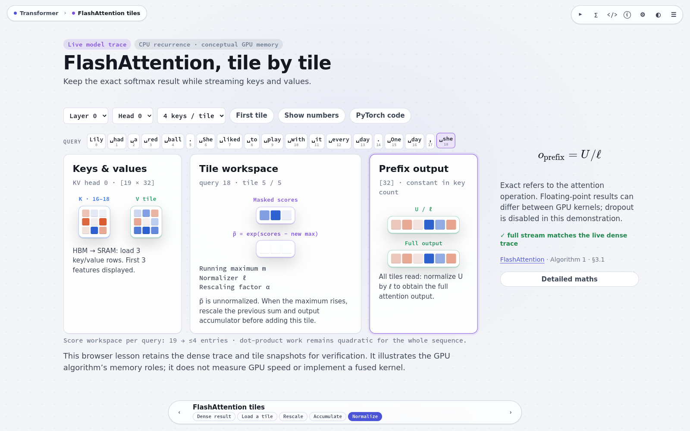

<p align="center">
  
</p>

<h1 align="center">Transformer Atlas</h1>

<p align="center">
  <strong>Understand transformers through live computation, equations, and code.</strong>
</p>

<p align="center">
  <a href="https://saidgurbuz.github.io/transformer-atlas/">Try the Atlas</a> ·
  <a href="https://saidgurbuz.github.io/transformer-atlas/#stepper">Code walkthrough</a> ·
  <a href="https://saidgurbuz.github.io/transformer-atlas/#exercises">Practice</a> ·
  <a href="CHANGELOG.md">v1.5.2</a>
</p>

Transformer Atlas is an interactive guide to the computations inside a Transformer. A small trained model runs in your browser: change its input, follow the forward pass, inspect a tensor, and connect its values to the equation and PyTorch operation that produce them.

Use it to learn the architecture, demonstrate it in a class, or revisit implementation details for research and technical interviews. Start with the 3D architecture overview, zoom into animated views of individual operations, and open deeper explanations as needed.

[](https://saidgurbuz.github.io/transformer-atlas/?preset=tinystories#model)

*From input tokens to the next-token prediction. Click the overview to explore the model, then zoom into any component.*

## Start exploring

1. **[Open the demo](https://saidgurbuz.github.io/transformer-atlas/?preset=tinystories).** The default TinyStories model reads words and subwords.
2. **Change the text** in **Model, weights & input**. The LM head updates its prediction after the final input token.
3. **Click a component to zoom in:** model → block → attention → head → scores, mask, softmax and value mixing. Follow the steps at the bottom of each view.
4. **Connect the picture to the implementation.** Hover a traced cell for its value and equation; right-click for maths, inspection or code. The top toolbar opens **Maths**, **Code**, and **Notes & sources** for the current view.

In the overview, **Shift-click an input token** or right-click → **Focus token** to explore its prediction while staying in the same view. Ordinary clicks open the token view. **Esc** zooms out or closes a drawer; **← / →** navigate the guided story.

## What you can explore

- **The complete decoder computation.** Tokenization, embedding lookup, positional information, normalization, Q/K/V projections, attention heads, residual additions, feed-forward layers, the LM head and sampling.
- **Actual tensors, shapes and values.** Choose a layer, head and token; inspect the traced calculation at a specific row and column. Matrix previews indicate continuation with dots.
- **Cells ↔ equations ↔ code.** Follow an exact tensor cell into the corresponding PyTorch source and return to its explanation. Source navigation follows the active architecture branch and exposes helper implementations.
- **Equations with context.** Read symbol definitions, configuration-specific formulas, expandable derivations, implementation conventions and references to the relevant papers or official documentation.
- **Generation and controlled experiments.** Follow token-by-token decoding and KV-cache reuse, adjust sampling, or use the ablation lab to inspect how changing components affects predictions.
- **Depth you can choose.** Guided scenes introduce the operation; detail drawers, executable references and study tools support implementation-level and research-level questions. Light and dark themes and reduced-motion support are included.

## A closer look

Follow attention connections, connect code to live tensors and equations, trace gradients, or work through tiled attention. Each preview opens its corresponding view in the Atlas.

<p>
  <a href="https://saidgurbuz.github.io/transformer-atlas/?preset=tinystories#attention.0"></a>
  <a href="https://saidgurbuz.github.io/transformer-atlas/?preset=tinystories#stepper"></a>
</p>
<p>
  <a href="https://saidgurbuz.github.io/transformer-atlas/?preset=tinystories#training"></a>
  <a href="https://saidgurbuz.github.io/transformer-atlas/?preset=tinystories#flash"></a>
</p>

## Lessons and study tools

| Explore | What you learn |
| --- | --- |
| [Code ↔ forward pass](https://saidgurbuz.github.io/transformer-atlas/#stepper) | Walk the PyTorch model line by line alongside its live tensors. |
| [Tensor operations](https://saidgurbuz.github.io/transformer-atlas/#tensor-ops) | Head layouts, shapes, strides, storage sharing, `view`, `transpose`, `reshape`, `cat`, `einsum` and singleton axes. |
| [One training step](https://saidgurbuz.github.io/transformer-atlas/#training) | Shifted targets, next-token loss, backpropagation, parameter gradients and consecutive SGD/AdamW updates. |
| [FlashAttention tiles](https://saidgurbuz.github.io/transformer-atlas/#flash) | Stable online softmax, running accumulators and tiled value mixing, checked against the live dense attention output. |
| [Encoder–decoder computation](https://saidgurbuz.github.io/transformer-atlas/#encoder-decoder) | Bidirectional encoder attention, causal decoder attention, rectangular cross-attention and padding masks. |
| [Architecture comparison](https://saidgurbuz.github.io/transformer-atlas/#architectures) | Original Transformer, GPT-2 and Llama-style structural choices, with equations, code and optional parameter counts. |
| [Ablation lab](https://saidgurbuz.github.io/transformer-atlas/#lab) | Explore the effect of attention-head, residual and MLP ablations. |
| [Params, FLOPs & memory](https://saidgurbuz.github.io/transformer-atlas/#scaling) | Reason about parameter counts, training/inference computation and memory requirements. |
| [Vision tokens](https://saidgurbuz.github.io/transformer-atlas/#vision) | Study how image patches become tokens and how vision-language models connect them to language. |
| [Transformer practice](https://saidgurbuz.github.io/transformer-atlas/#exercises) | Sixteen shape, derivation, debugging and runnable JavaScript exercises, with worked solutions and browser-local progress. |
| [Interview cheat sheet](https://saidgurbuz.github.io/transformer-atlas/#cheatsheet) | Review formulas and live shapes, then use flashcards and a quiz. |

The training and encoder–decoder lessons use separate miniature models. Architecture counts illustrate their disclosed recipes. The FlashAttention lesson demonstrates the recurrence on CPU, with illustrations of the GPU algorithm's memory roles. [Lesson conventions and verification](docs/LESSONS.md) explain these examples in detail.

## Going deeper

Open **Maths → Further study** from a relevant equation card. Derivations and implementation links start collapsed, and source links include a return action to the explanation.

<details>
<summary><strong>Advanced equations and executable research references</strong></summary>

- **Backward computation:** the complete attention gradient chain, shared/broadcast gradient sums, LayerNorm and RMSNorm derivatives, and the implemented activation derivatives.
- **Invariants and counterexamples:** softmax shifts, convex combinations, normalization with epsilon, head basis changes, permutation properties and cached-decoding equivalence.
- **Interpretation:** QK/OV circuits, feed-forward value directions, vocabulary projections and the evidence needed to support causal interpretations.
- **Numerical contracts:** Boolean/additive masks, rectangular causal alignment, dropout, grouped-query attention and precision-sensitive comparisons.
- **Modern attention references:** L2/RMS QK normalization, smooth score capping, positional interpolation and YaRN, and multi-head latent attention (MLA).

These research chapters use dedicated numerical examples and executable Python references. Their paper conventions, assumptions and relationship to the main model are documented in [Research content and validation](docs/RESEARCH_CONTENT.md).

</details>

## Built-in models

Five compact trained presets provide different patterns to explore. Switch models through **Model, weights & input**, or open one directly:

| Preset | Explore |
| --- | --- |
| [TinyStories](https://saidgurbuz.github.io/transformer-atlas/?preset=tinystories) | Byte-level BPE with a 4,096-token vocabulary, a GPT-2-style architecture and tied embeddings. |
| [Alice · GPT-2 style](https://saidgurbuz.github.io/transformer-atlas/?preset=charlm) | Character-level prediction with learned positions, LayerNorm and GELU. |
| [Alice · Llama style](https://saidgurbuz.github.io/transformer-atlas/?preset=llama) | RoPE, RMSNorm, SwiGLU and grouped-query attention. |
| [Induction heads](https://saidgurbuz.github.io/transformer-atlas/?preset=induction) | Patterns learned to continue repeated sequences. |
| [Word reversal](https://saidgurbuz.github.io/transformer-atlas/?preset=reverse) | Attention patterns learned to read a word backwards. |

The presets are educational models. TinyStories reports held-out metrics; the Alice models report training-set metrics, and the induction/reversal models report synthetic-task accuracy. Details are in the [preset manifest](src/presets/manifest.js).

<details>
<summary><strong>Configurable architecture choices</strong></summary>

| Component | Main-model options |
| --- | --- |
| Attention | Multi-head (MHA), multi-query (MQA) and grouped-query (GQA) attention |
| Position information | Learned embeddings, sinusoidal encodings, RoPE, ALiBi or no explicit positional encoding |
| Normalization | LayerNorm or RMSNorm; pre-norm or post-norm placement |
| Feed-forward layers | GELU, ReLU or SwiGLU |
| Attention masks | Causal, sliding-window, bidirectional or prefix-LM |
| Other choices | Tied/untied vocabulary weights, biases, attention-score scaling and residual connections |

Changes that alter parameter shapes initialize a new model; compatible changes retain the weights for exploration. See [the reference model's coverage and conventions](docs/MODEL_REFERENCE.md).

</details>

## Computation and verification

The browser executes a JavaScript tensor engine with reverse-mode automatic differentiation. [`reference/model.py`](reference/model.py) is its readable PyTorch counterpart; trace markers connect operations across both implementations. [`reference/numpy_transformer.py`](reference/numpy_transformer.py) provides an explicit, hand-written backward pass for studying the derivatives.

Verification covers traced outputs and gradients, cached/full decoding, pretrained logits, tokenization, live equation values, source correspondence and browser interactions. The independent PyTorch fixtures and the [verification commands](docs/DEVELOPMENT.md#verify-the-computation-and-content) are included in the repository.

## Run locally

The live demo needs no installation or API key. To run a source checkout, serve its static files:

```bash
git clone https://github.com/Saidgurbuz/transformer-atlas.git
cd transformer-atlas
python3 -m http.server 8000
```

Open **[localhost:8000](http://localhost:8000)** in a modern browser. The 3D overview uses WebGL; running the source app requires no npm installation.

For a single-file version, [open the standalone HTML](https://saidgurbuz.github.io/transformer-atlas/transformer-atlas.html), save it locally, and reopen it directly in your browser. To build that file yourself, follow [the development guide](docs/DEVELOPMENT.md#build-the-standalone-app).

## Feedback and contributions

Teaching feedback, corrections to explanations or equations, reproducible bugs and focused improvements are welcome. [Open an issue](https://github.com/Saidgurbuz/transformer-atlas/issues) with the view or topic, model preset and input that illustrate your suggestion.

- [Development, verification and deployment](docs/DEVELOPMENT.md)
- [Adding Atlas scenes](docs/ATLAS_GUIDE.md)
- [Math catalogue and notation](docs/MATH_GUIDE.md)
- [Executable lessons](docs/LESSONS.md) and [research references](docs/RESEARCH_CONTENT.md)
- [Changelog](CHANGELOG.md)
